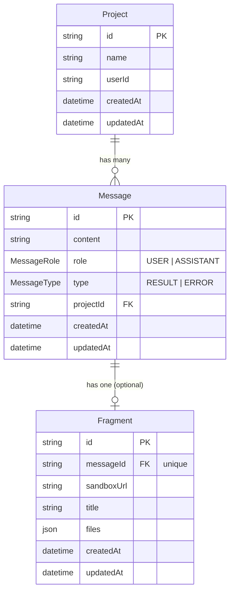
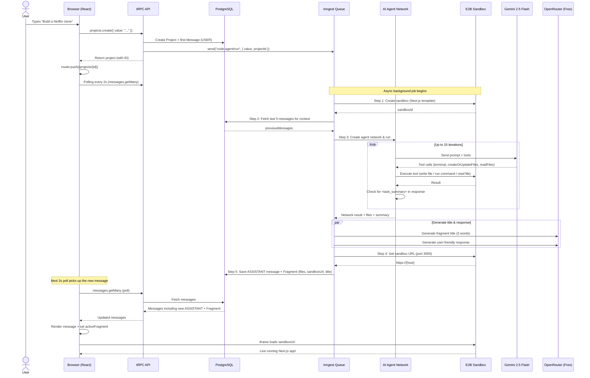
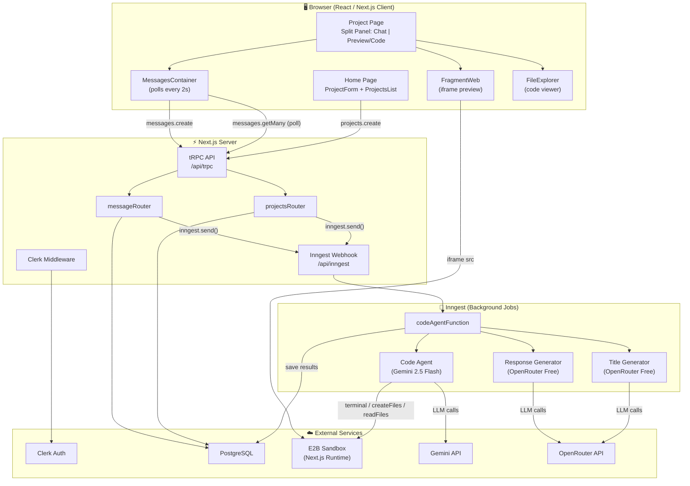

# 🧞 Genie — Complete Architecture & Flow Guide

## What is Genie?

**Genie is an AI-powered "vibe coding" platform** — a web app where users describe what they want to build in plain English (e.g., "Build me a Netflix clone"), and an AI agent writes the full Next.js code, deploys it in a live sandbox, and shows the result in a live preview iframe — all within seconds.

Think of it as a **Bolt.new / v0.dev clone**: the user chats, the AI codes, and a real running app appears on the right side of the screen.

---

## Core Features

| Feature | Description |
|---|---|
| 🔐 **Auth (Clerk)** | Sign up / sign in with Clerk. All projects are user-scoped. |
| 💬 **Chat-to-Code** | User types a prompt → AI generates a full Next.js app in a sandbox |
| 🤖 **Multi-Agent AI Pipeline** | Inngest Agent Kit orchestrates a coding agent + title generator + response summarizer |
| 📦 **Cloud Sandbox (E2B)** | Each request spins up a sandboxed Next.js environment with file system & terminal access |
| 👁️ **Live Preview** | The generated app runs on a real URL, embedded in an iframe |
| 📂 **Code Viewer** | Browse & read all generated files in a VS-Code-style tree with syntax highlighting |
| ⬇️ **Download as ZIP** | Export the generated project (merged with boilerplate) as a zip |
| 📁 **Project Management** | Each prompt creates a "project"; users can revisit & iterate on past projects |
| 🔄 **Iterative Conversation** | Send follow-up messages inside a project to modify / extend the generated app |
| 🌙 **Dark/Light/System Theme** | next-themes powered theme toggle |

---

## Tech Stack

| Layer | Technology |
|---|---|
| Framework | **Next.js 16** (App Router, Turbopack) |
| Language | **TypeScript** |
| Auth | **Clerk** (`@clerk/nextjs`) |
| API Layer | **tRPC v11** (type-safe RPC) |
| Data Fetching | **TanStack React Query v5** |
| Database | **PostgreSQL** via **Prisma 7** (with `@prisma/adapter-pg`) |
| AI Orchestration | **Inngest v4** + **@inngest/agent-kit** |
| AI Models | **Gemini 2.5 Flash** (coding) + **OpenRouter** free models (titles & summaries) |
| Sandbox | **E2B** (`@e2b/code-interpreter`) |
| UI | **Shadcn/UI** + **Radix UI** + **Tailwind CSS v4** |
| Misc | JSZip, PrismJS, react-resizable-panels, react-textarea-autosize |

---

## File-by-File Architecture

### 📁 Root Configuration

| File | Purpose |
|---|---|
| [package.json](package.json) | Dependencies, scripts (`dev`, `build`, `start`). Uses Turbopack for dev. |
| [prisma/schema.prisma](prisma/schema.prisma) | Database schema — 3 models: `Project`, `Message`, `Fragment` |
| [prisma.config.ts](prisma.config.ts) | Prisma configuration |
| [.env](.env) | Environment variables (API keys, DB URL, Clerk keys) |
| [next.config.ts](next.config.ts) | Next.js config |
| [components.json](components.json) | Shadcn/UI configuration |

### 📁 Database Schema (`prisma/`)

- **Project** — a conversation workspace owned by a user
- **Message** — a chat message (either from USER or ASSISTANT)
- **Fragment** — the generated code artifact attached to an ASSISTANT message (sandbox URL + files JSON)

### 📁 App Entry Points (`src/app/`)

| File | Purpose |
|---|---|
| [src/app/layout.tsx](src/app/layout.tsx) | Root layout. Wraps everything in `ClerkProvider` → `TRPCReactProvider` → `ThemeProvider`. Sets fonts (Outfit + Geist Mono). |
| [src/app/globals.css](src/app/globals.css) | Global Tailwind CSS styles and theme variables |

### 📁 Home Page (`src/app/(home)/`)

| File | Purpose |
|---|---|
| [src/app/(home)/layout.tsx](src/app/(home)/layout.tsx) | Home layout with `Navbar`, ambient background glows (gradient orbs) |
| [src/app/(home)/page.tsx](src/app/(home)/page.tsx) | Landing page — "Make a Wish" hero + `ProjectForm` + `ProjectsList` |
| [sign-in page](src/app/(home)/sign-in/[[...sign-in]]/page.tsx) | Clerk sign-in page |
| [sign-up page](src/app/(home)/sign-up/[[...sign-up]]/page.tsx) | Clerk sign-up page |

### 📁 Project Page (`src/app/projects/`)

| File | Purpose |
|---|---|
| [src/app/projects/[projectId]/page.tsx](src/app/projects/[projectId]/page.tsx) | Dynamic route. Server-side prefetches messages & project data, then renders `ProjectView` inside a `HydrationBoundary`. |

### 📁 API Routes (`src/app/api/`)

| File | Purpose |
|---|---|
| [src/app/api/trpc/[trpc]/route.ts](src/app/api/trpc/[trpc]/route.ts) | tRPC HTTP handler — catch-all route that delegates to the `appRouter` |
| [src/app/api/inngest/route.ts](src/app/api/inngest/route.ts) | Inngest webhook endpoint — serves the `codeAgentFunction` |

### 📁 Auth Middleware

| File | Purpose |
|---|---|
| [src/middleware.ts](src/middleware.ts) | Clerk middleware. Public routes: `/`, `/sign-in`, `/sign-up`, `/api/*`, `/pricing`. Everything else requires authentication. |

### 📁 tRPC Layer (`src/trpc/`)

| File | Purpose |
|---|---|
| [src/trpc/init.ts](src/trpc/init.ts) | tRPC initialization. Creates context from Clerk `auth()`. Defines `protectedProcedure` middleware (checks `userId`). Uses `superjson` transformer. |
| [src/trpc/routers/_app.ts](src/trpc/routers/_app.ts) | Root router — merges `messageRouter` + `projectsRouter` |
| [src/trpc/client.tsx](src/trpc/client.tsx) | Client-side tRPC setup. Creates `TRPCReactProvider` wrapping `QueryClientProvider` + `TRPCProvider`. Points to `/api/trpc`. |
| [src/trpc/server.tsx](src/trpc/server.tsx) | Server-side tRPC caller + options proxy for SSR prefetching |
| [src/trpc/query-client.ts](src/trpc/query-client.ts) | Query client factory with default stale time settings |

### 📁 Server Procedures (Business Logic)

| File | Purpose |
|---|---|
| [src/modules/projects/server/procedures.ts](src/modules/projects/server/procedures.ts) | **Projects Router**: `getOne` (fetch project + messages + fragments), `getMany` (list user's projects), `create` (create project + first message + **fire Inngest event**) |
| [src/modules/messages/server/procedures.ts](src/modules/messages/server/procedures.ts) | **Messages Router**: `getMany` (fetch messages for project), `create` (add message to existing project + **fire Inngest event**) |

> [!IMPORTANT]
> Both `create` mutations fire `inngest.send({ name: "code-agent/run" })` — this is the trigger that kicks off the AI coding pipeline.

### 📁 AI Engine — Inngest Agent Kit (`src/inngest/`)

This is **the brain of the app**. The most critical files:

| File | Purpose |
|---|---|
| [src/inngest/client.ts](src/inngest/client.ts) | Inngest client instance (`id: "Genie"`) |
| [src/inngest/functions.ts](src/inngest/functions.ts) | **The main AI pipeline** — the `codeAgentFunction` that orchestrates everything |
| [src/inngest/utils.ts](src/inngest/utils.ts) | Helpers: `retryWithBackoff` (429 handling), `getSandbox`, `lastAssistantTextMessageContent`, `parseAgentOutput` |

### 📁 AI Prompts

| File | Purpose |
|---|---|
| [src/prompt.ts](src/prompt.ts) | Three prompts: `PROMPT` (massive coding system prompt for the agent), `RESPONSE_PROMPT` (summarize what was built), `FRAGMENT_TITLE_PROMPT` (generate 3-word title) |

### 📁 Shared Libraries (`src/lib/`)

| File | Purpose |
|---|---|
| [src/lib/db.ts](src/lib/db.ts) | Prisma client singleton (uses `@prisma/adapter-pg` with a connection pool) |
| [src/lib/boilerplate.ts](src/lib/boilerplate.ts) | Static Next.js boilerplate files (`package.json`, `tsconfig.json`, etc.) merged into downloads |
| [src/lib/utils.ts](src/lib/utils.ts) | `cn()` Tailwind merge utility + `convertFilesToTreeItems()` for the file explorer |

### 📁 UI Components — Home Module (`src/modules/home/`)

| File | Purpose |
|---|---|
| [src/modules/home/constants.ts](src/modules/home/constants.ts) | 8 project templates (Netflix clone, Kanban board, Spotify clone, etc.) with emoji + prompt |
| [navbar.tsx](src/modules/home/ui/components/navbar.tsx) | Top navbar with logo, sign-in/sign-up buttons (when signed out), or UserControl avatar (when signed in) |
| [project-form.tsx](src/modules/home/ui/components/project-form.tsx) | Main prompt textarea with template buttons. On submit → calls `projects.create` mutation → redirects to project page |
| [projects-list.tsx](src/modules/home/ui/components/projects-list.tsx) | Grid of recent projects with timestamps, linking to each project page |

### 📁 UI Components — Project Module (`src/modules/projects/`)

| File | Purpose |
|---|---|
| [project-view.tsx](src/modules/projects/ui/views/project-view.tsx) | **Main project workspace**. Resizable split-panel: Left = chat, Right = preview/code tabs. Manages `activeFragment` state. Has download-as-zip logic. |
| [messages-container.tsx](src/modules/projects/ui/components/messages-container.tsx) | Renders message list + `MessageForm`. **Polls every 2 seconds** (`refetchInterval: 2000`) to pick up new AI responses. Auto-scrolls & auto-selects latest fragment. |
| [message-card.tsx](src/modules/projects/ui/components/message-card.tsx) | Renders a single message. User messages → right-aligned bubble. Assistant messages → left-aligned with logo + clickable `FragmentCard`. |
| [message-form.tsx](src/modules/projects/ui/components/message-form.tsx) | Follow-up message textarea within a project. Calls `messages.create` mutation. |
| [fragment-web.tsx](src/modules/projects/ui/components/fragment-web.tsx) | Live preview iframe showing the sandbox URL. Has refresh, copy-URL, and open-in-new-tab buttons. |
| [project-header.tsx](src/modules/projects/ui/components/project-header.tsx) | Header with project name, dropdown to go back to dashboard, and theme switcher |
| [message-loading.tsx](src/modules/projects/ui/components/message-loading.tsx) | Shimmer loading animation shown while AI is generating ("Thinking...", "Building your website...", etc.) |
| [usage.tsx](src/modules/projects/ui/components/usage.tsx) | Usage/quota display component |

### 📁 Shared UI Components (`src/components/`)

| File | Purpose |
|---|---|
| [file-explorer.tsx](src/components/file-explorer.tsx) | VS-Code-style file tree + code viewer. Split panel: tree on left, syntax-highlighted code on right with breadcrumbs & copy button. |
| [tree-view.tsx](src/components/tree-view.tsx) | Recursive tree view component for folder/file navigation |
| [code-view/index.tsx](src/components/code-view/index.tsx) | PrismJS-powered syntax highlighting |
| [hint.tsx](src/components/hint.tsx) | Tooltip wrapper |
| [user-control.tsx](src/components/user-control.tsx) | Clerk `<UserButton />` wrapper |
| [ui/*](src/components/ui) | ~30 Shadcn/UI components (Button, Card, Tabs, Resizable, Sidebar, etc.) |

### 📁 E2B Sandbox Template (`sandbox-templates/nextjs/`)

| File | Purpose |
|---|---|
| [e2b.Dockerfile](sandbox-templates/nextjs/e2b.Dockerfile) | Docker image for sandbox: Node 21, creates a Next.js 15.3.3 app, installs **all** Shadcn components, Tailwind, etc. |
| [compile_page.sh](sandbox-templates/nextjs/compile_page.sh) | Helper script for sandbox compilation |
| [e2b.toml](sandbox-templates/nextjs/e2b.toml) | E2B sandbox configuration (template ID, etc.) |

---

## Complete Request Flow — Step by Step

Here's exactly what happens when a user types "Build me a Netflix clone" and hits submit:

### Step-by-Step Walkthrough

#### 1. User lands on Home Page (`/`)
- `src/app/(home)/layout.tsx` renders the `Navbar` + ambient gradient background
- `src/app/(home)/page.tsx` shows the "Make a Wish" hero, `ProjectForm` textarea, and `ProjectsList`
- If not signed in, navbar shows Sign In / Sign Up buttons

#### 2. User types a prompt and submits
- `project-form.tsx` validates with Zod, calls `projects.create` via tRPC mutation
- **Or** user clicks a template button (e.g., "🎬 Build a Netflix clone") which pre-fills the textarea

#### 3. Server creates the project
- `src/modules/projects/server/procedures.ts` `create` mutation:
  1. Creates a `Project` with a random slug name (via `random-word-slugs`)
  2. Creates the first `Message` (role: USER)
  3. **Fires Inngest event**: `inngest.send({ name: "code-agent/run", data: { value, projectId } })`
  4. Returns the project → browser navigates to `/projects/{id}`

#### 4. Project page loads with polling
- `src/app/projects/[projectId]/page.tsx` server-side prefetches messages + project data
- `project-view.tsx` renders the split-panel layout
- `messages-container.tsx` starts **polling every 2 seconds** via `refetchInterval: 2000`
- Shows `MessageLoading` shimmer ("Thinking...", "Building your website...") while waiting

#### 5. Inngest processes the AI pipeline (async, in background)
- `src/inngest/functions.ts` — the `codeAgentFunction`:

  **Step A — Create Sandbox**: Spins up an E2B sandbox from the custom template (`tanushsingh843/genie-nextjs-test2`). This template pre-installs Next.js 15.3.3 + all Shadcn components + Tailwind.

  **Step B — Fetch Context**: Gets last 5 messages from DB for conversation history.

  **Step C — Run Agent Network**: Creates a `codeAgent` powered by **Gemini 2.5 Flash** with 3 tools:
  - `terminal` — runs shell commands in the sandbox (e.g., `npm install`)
  - `createOrUpdateFiles` — writes files to the sandbox filesystem
  - `readFiles` — reads files from the sandbox

  The agent runs in a network with `maxIter: 15`. On each iteration, the router checks if a `<task_summary>` has been produced. If yes → stop. If no → route back to `codeAgent`.

  **Step D — Generate metadata**: Two smaller agents (using **free OpenRouter models**) run in parallel:
  - `fragmentTitleGenerator` → produces a 3-word title (e.g., "Netflix Clone")
  - `responseGenerator` → produces a user-friendly summary (e.g., "Here's your Netflix-style homepage with a hero banner...")

  **Step E — Get sandbox URL**: Gets the public URL for port 3000 of the sandbox.

  **Step F — Save to DB**: Creates an ASSISTANT `Message` with an attached `Fragment` containing the sandbox URL, title, and all generated files as JSON.

#### 6. Browser picks up the result
- Next poll (within 2 seconds) fetches the new ASSISTANT message + Fragment
- `MessagesContainer` auto-selects the latest fragment as `activeFragment`
- The right panel shows:
  - **Preview tab**: iframe loads the sandbox URL → user sees the live running app
  - **Code tab**: `FileExplorer` renders the generated files in a tree view with syntax highlighting

#### 7. User iterates
- User types a follow-up message in the project's `MessageForm`
- `src/modules/messages/server/procedures.ts` `create` mutation saves the message and fires another Inngest event
- The whole pipeline repeats, with the last 5 messages as context for the AI

#### 8. Download
- User clicks the Download button → `handleDownload` in `project-view.tsx`
- Merges the AI-generated files with `NEXTJS_BOILERPLATE` (from `src/lib/boilerplate.ts`)
- Zips everything with JSZip and triggers a browser download

---

## Architecture Diagram

---

## Key Design Decisions

> **Polling over WebSockets**: The app uses a 2-second polling interval rather than WebSockets/SSE. This is simpler to implement and works well for the use case since AI generation takes 10-60 seconds anyway.

> **Inngest for durability**: Using Inngest (not raw API calls) ensures the AI pipeline is retry-safe, observable, and won't be killed by serverless timeouts. Each step is individually retried.

> **Free models for metadata**: The title and response generators use free OpenRouter models (`nemotron-nano-9b-v2:free`), keeping costs low since only the main coding agent needs a powerful model.

> **Sandbox isolation**: E2B sandboxes are fully isolated containers. The AI agent can run arbitrary `npm install` commands, write files, and execute code without affecting the host server.
